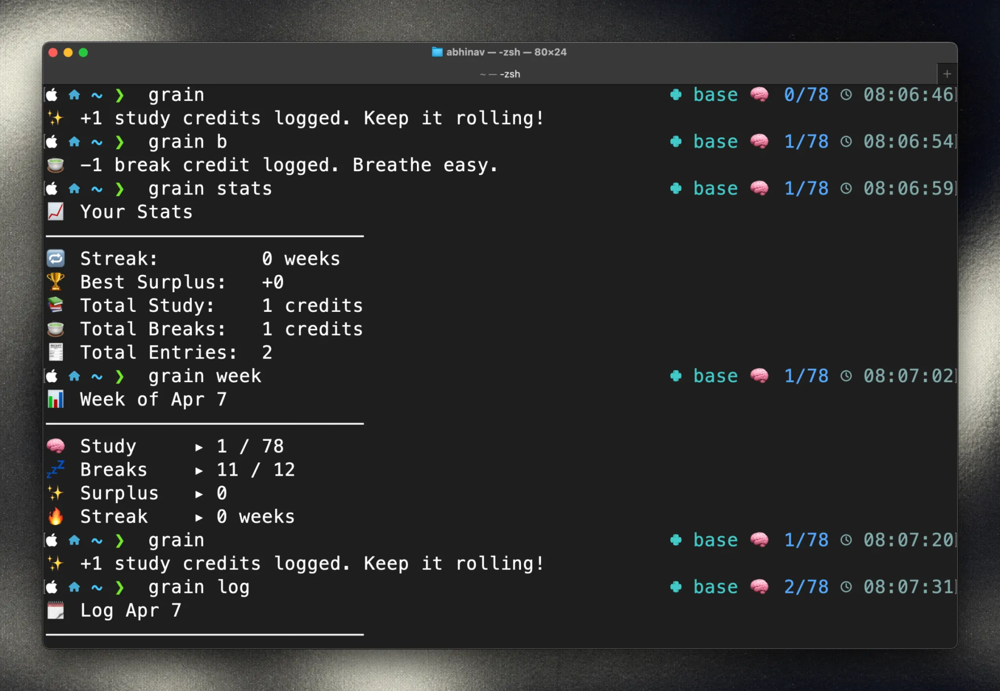

# Why I built grain
_(and why it matters, even if nothing else does)_

When I failed JEE for the last time, I wasn’t just grieving a test. I was mourning a **version of myself** I thought I’d become.  

But somewhere in that stillness, I found something that didn't need motivation to exist: **ritual.**

*grain* is not a productivity app. It’s a **companion** for the slow, deliberate act of continuing. It runs in your terminal. It doesn’t sync. It doesn’t push notifications or pretend to be your friend.

It just counts—**one hour, one credit at a time**.

You earn **90 credits a week**. Surplus becomes your break time.

Because when everything else falls apart, the only question worth answering is: _can I still show up?_

  

And **grain** answers, without fanfare: **yes. once more.**



## Philosophy

Ahh, the age-old millennium question. Why does the world need yet another time-logging tool for studying?

#### What grain is

I built this around a simple idea: consistency shouldn't depend on how motivated you feel. It should be something you can return to, even on the days when ambition feels distant.

It treats time as something you consciously invest. Every hour counts. Every credit represents time spent doing what you said mattered.

It also recognises that effort needs rest. Your time isn't an infinite resource, and neither should your expectations of yourself be.

#### What grain isn't

There are no streaks or notifications. That is by design.

It won't tell you to optimise every minute, or wake up at 5 AM.

It doesn't measure your worth, your potential, or how much you've accomplished compared to someone else.

And it certainly won't manufacture motivation for you.

#### What it comes down to

Grain doesn't care about your best day. It cares whether you can come back after a bad one.

Work when you can. Rest when you've earned it. Start again when you're ready.

**No grand promises. Just the quiet discipline of continuing.**

## Installation

1.  **Ensure Go is installed:** You need Go (version 1.18 or later recommended). Check with `go version`.
2.  **Clone the repository:**
    ```bash
    # git clone https://github.com/CodeDreamer06/GrainCLI.git 
    # cd grainCLI
    ```
3.  **Build the binary:**
    ```bash
    go build -o grain .
    ```
    This creates the `grain` executable in the current directory.
4.  **Move to PATH (Optional but recommended):**
    Move the compiled `grain` binary to a directory in your system's `$PATH` (e.g., `/usr/local/bin` or `~/bin`) for easy access from anywhere.
    ```bash
    # Example for macOS/Linux:
    # sudo mv grain /usr/local/bin/ 
    # Or choose a user-specific path:
    # mkdir -p ~/bin && mv grain ~/bin # Ensure ~/bin is in your PATH
    ```

## First Run

The first time you run `grain` (or any `grain` command), it will check for `~/.grain/config.json`. If not found, it will prompt you for initial setup:

```txt
👋 Welcome to Grain CLI!

Enter your study goal per week (default: 90): 90
Set initial break credits (default: 12): 12
✨ Configuration saved to /Users/yourname/.grain/config.json
```

This creates `~/.grain/config.json` and `~/.grain/data.json` (initially empty or with default stats).

## Usage

Grain uses simple commands for core actions.

### Logging Credits

*   `grain`: Logs **+1 study credit** (default action).
*   `grain <N>`: Logs **+N study credits** (e.g., `grain 3`).
*   `grain s [N]`: Logs **+N study credits** (e.g., `grain s` or `grain s 2`). `N` defaults to 1 if omitted.
*   `grain b [N]`: Logs **-N break credits** (e.g., `grain b` or `grain b 5`). `N` defaults to 1 if omitted.
    *   *Constraint:* You cannot log more break credits than currently available for the week.

**Example Output:**

```bash
grain 3
```
```txt
✨ +3 study credits logged. Keep it rolling!
```

```bash
grain b
```
```txt
🍵 -1 break credit logged. Breathe easy.
```

### Viewing Data

*   `grain log`: View today's log entries.
    ```txt
    🗓️  Log for Jul 15
    ────────────────────────────
    [09:30] +2 study
    [11:05] +1 study
    [14:00] -1 break
    
    Total ▸ 🧠 3 study   💤 1 break
    ```
*   `grain week`: View the current weekly overview (Monday-Sunday, excluding Sunday logs).
    ```txt
    📊 Week of Jul 15
    ────────────────────────────
    🧠 Study     ▸ 74 / 90
    💤 Breaks    ▸ 4 / 12
    ✨ Surplus   ▸ 0
    🔥 Streak    ▸ 4 weeks
    ```
*   `grain stats`: Show overall historical statistics.
    ```txt
    📈 Your Stats
    ────────────────────────────
    🔁 Streak:         4 weeks
    🏆 Best Surplus:   +18
    📚 Total Study:    210 credits
    🍵 Total Breaks:   35 credits
    🧾 Total Entries:  85
    ```

### Actions & Management

*   `grain undo`: Reverts the **last logged action** (study or break) and updates stats.
    ```txt
    🔙 Undid log: [14:00] -1 break
    Remaining undo steps: 8
    ```
*   `grain config`: Opens `~/.grain/config.json` in your system's default editor. It respects the `$EDITOR` environment variable or falls back to `vim`, `nano`, or `code` if found.
    ```txt
    Attempting to open /Users/yourname/.grain/config.json with vim...
    Editor closed. Configuration changes will be applied the next time you run grain.
    ```
*   `grain reset`: Prompts to **delete all log entries for the current week** (Monday-Sunday). Requires confirmation by typing `reset grain`.
    ```txt
    ⚠️  Are you sure you want to reset this week's data?
    Type "reset grain" to confirm: reset grain
    🧹 Current week data has been reset.
    ```
*   `grain backup`: Creates a timestamped backup of `data.json` in the `~/.grain/backups/` directory.
    ```txt
    🗃️ Backup saved to: ~/.grain/backups/backup_2024-07-15_10-30-00.json
    ```
*   `grain restore <filename.json>`: Replaces the current `data.json` with the contents of a specific backup file from the `~/.grain/backups/` directory. Requires confirmation by typing `yes`.
    ```bash
    grain restore backup_2024-07-15_10-30-00.json
    ```
    ```txt
    ⚠️ This will overwrite current data with the contents of 'backup_2024-07-15_10-30-00.json'.
    Type "yes" to confirm: yes
    ♻️ Data restored from backup_2024-07-15_10-30-00.json and current stats recalculated.
    ```

## Data Storage

All application data is stored locally within the `~/.grain/` directory:

*   `~/.grain/config.json`: User configuration (weekly goal, break start). Edit via `grain config` or manually.
*   `~/.grain/data.json`: Contains all log entries (`logs`), weekly surplus history (`weekly_surplus`), current streak (`streak`), best surplus ever (`best_surplus`), and the undo stack (`undo_stack`).
*   `~/.grain/backups/`: Stores timestamped JSON backups created with `grain backup`.

## Core Logic Summary

*   **Weekly Goal:** Set in `config.json` (default `90`). This is the target number of *study* credits per week.
*   **Break Credits:** You start each week (Monday) with a base number of break credits set in `config.json` (default `12`).
*   **Surplus Bonus:** If your total *study* credits for the week exceed the `weekly_goal`, each extra study credit earns you **+2** additional break credits *for that week*. Surplus = `(StudyCredits - WeeklyGoal) * 2`.
*   **Break Cap:** Available break credits at the start of the week are capped by `break_start` in the config. Surplus earned during the week can increase this.
*   **Weekly Cycle:** Weeks run Monday to Sunday. Stats like available breaks and goal progress reset on Monday. **Logging is disabled on Sundays.**
*   **Streak:** Tracks the number of *consecutive previous weeks* where the `weekly_goal` for study credits was met or exceeded.
*   **Undo:** Uses a stack (`undo_stack` in `data.json`) to allow reversing log actions infinitely.

## Development

*   Uses Go standard library and `github.com/spf13/cobra` for CLI structure.
*   Build: `go build -o grain .`
*   Format: `go fmt ./...`
*   Tidy dependencies: `go mod tidy`
*   Run tests (if any added): `go test ./...`

---

*Study. Pause. Repeat.*
